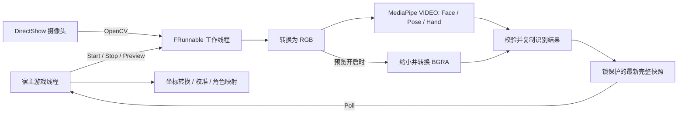

# 实现原理与源码导览

MotionCapture 在同一后台线程采集和识别，将最新完整结果交给游戏线程。角色加载、重定向、卡通材质和面板属于宿主。

## 采集与推理

`Start` 在游戏线程检查参数、插件位置、运行文件和引擎 OpenCV，再创建低于普通优先级的工作线程。相机和 SDK 是否真正可用由后续状态报告。

后台初始化 COM，动态加载固定版本 `libmediapipe.dll`，解析 C API 导出并创建面部、手部和身体任务。三类任务均使用 CPU delegate 与 VIDEO 模式；同一采集图像、同一时间戳依次送入三项任务。最多配置一个人脸、一个姿态和两只手。

OpenCV 通过 DirectShow 读帧，把灰度/BGR/BGRA 转为 RGB。原生包装层要求严格递增的毫秒时间戳，对带行填充的 RGB 整理成连续图像。驱动可能拒绝请求参数，因此实际尺寸从快照读取。

SDK 结果检查数组数量、指针、数值有限性与面部矩阵。面部矩阵移除各轴尺度、检查正交性与旋转方向，再提取归一化右手四元数；表情分数限制到 `[0,1]`。关键点保留 SDK 坐标与可选置信信息，未识别部位为空。

可选面部点读取失败会清空面点，保留其他有效识别；核心任务失败则发布错误。三项任务全部完成后才发布该帧，不拼接不同采集时刻的部位。独立任务的同帧结果并不代表空间原点或估计误差已被统一。

## 快照与停止

`FFrameState` 用锁保护最新快照、序号和时间戳。发布整份替换，`Poll` 整份复制，旧帧不排队等待。相机图像默认不传到游戏线程，预览打开时才生成小图及面部覆盖点。

`Stop` 设置停止标志并发布清空追踪的 Stopping 快照，然后唤醒后台。刚完成的晚到推理不能覆盖停止请求。相机和 SDK 由创建它们的工作线程释放，结束后发布 Stopped 或 Error。模块保留活动线程，卸载时请求停止并等待退出。

OpenCV 由 UE `OpenCVHelper` 持有。预检查只读调用 `GetModuleHandleW`，不增加引用，也不释放借用句柄。MediaPipe DLL 由原生包装层自行加载和释放；两种所有权不能混用。

## 源码位置

| 文件 | 责任 |
| --- | --- |
| [HonkaiMotionCapture.h](../Source/HonkaiMotionCapture/Public/HonkaiMotionCapture.h) | 设置、状态、快照与公开 API |
| [HonkaiMotionCapture.cpp](../Source/HonkaiMotionCapture/Private/HonkaiMotionCapture.cpp) | UE 线程、相机、预览、快照及轮询 |
| [NativeMediaPipe.cpp](../Source/HonkaiMotionCapture/Private/NativeMediaPipe.cpp) | SDK 加载、任务调用、输入和结果校验 |
| [PreviewPixels.cpp](../Source/HonkaiMotionCapture/Private/PreviewPixels.cpp) | 有界 RGB→BGRA 复制与缓冲校验 |
| [OpenCvRuntimeCheck.cpp](../Source/HonkaiMotionCapture/Private/OpenCvRuntimeCheck.cpp) | 不改变所有权的 OpenCV 检查 |
| [HonkaiMotionCaptureModule.cpp](../Source/HonkaiMotionCapture/Private/HonkaiMotionCaptureModule.cpp) | 模块卸载和动态重载限制 |
| [HonkaiMotionCapture.Build.cs](../Source/HonkaiMotionCapture/HonkaiMotionCapture.Build.cs) | 平台、引擎依赖及打包文件 |
| [Stage-LocalRuntime.ps1](../Scripts/Stage-LocalRuntime.ps1) | 本地固定哈希校验和复制 |

## 设计边界

进程内架构消除额外识别进程与文件轮询，也失去进程级故障隔离。SDK 或驱动的严重错误可能终止 UE；协作停止不能解除所有阻塞。异常处理和数组检查不能保证原生运行库永不崩溃。

当前没有相机录制、网络沙箱、遥测设置、GPU 推理选项、用户标定或模型专用参数。扩展这些能力时，须明确与线程、许可和宿主职责的关系，不能将现有接口解释为已经具备。
